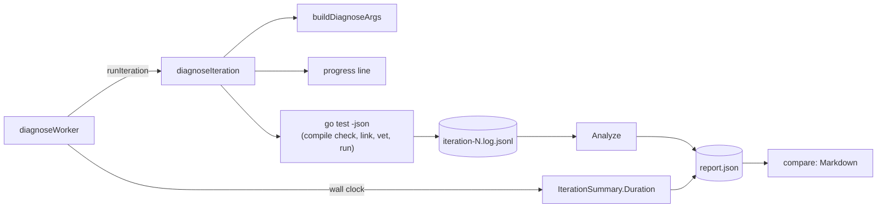
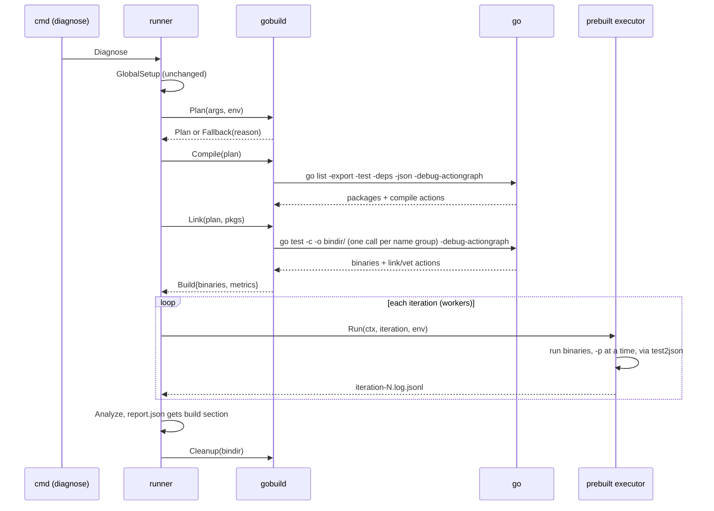
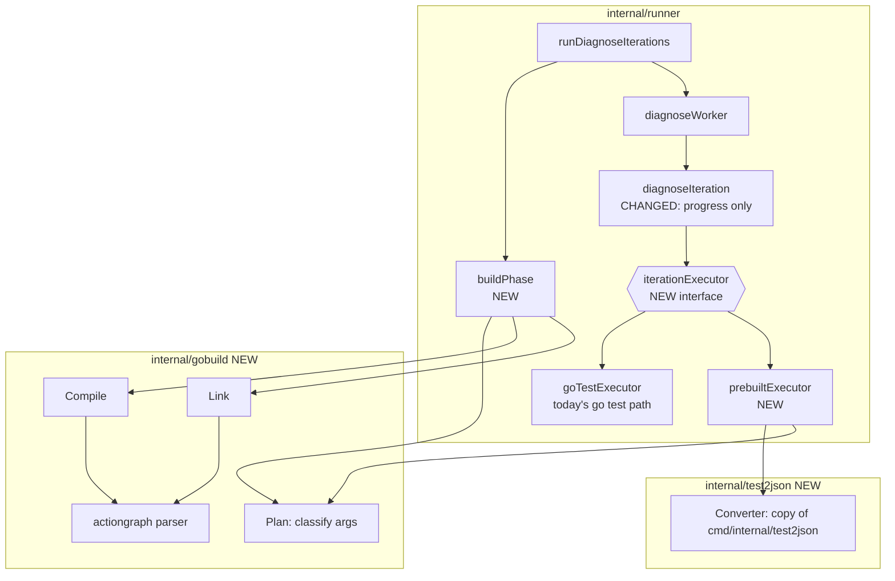
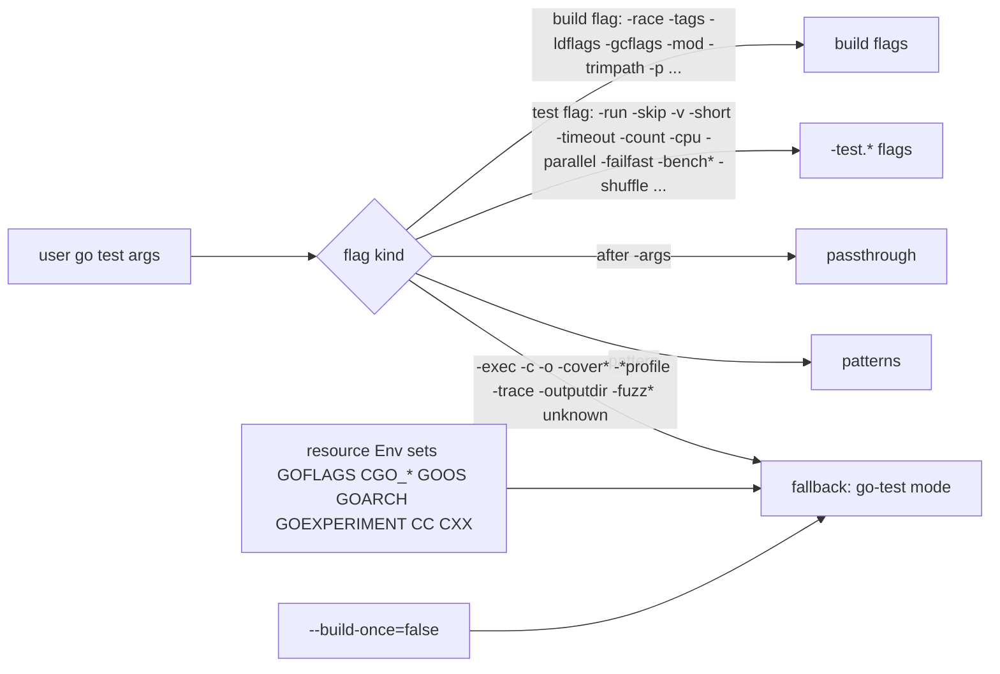
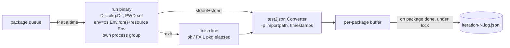
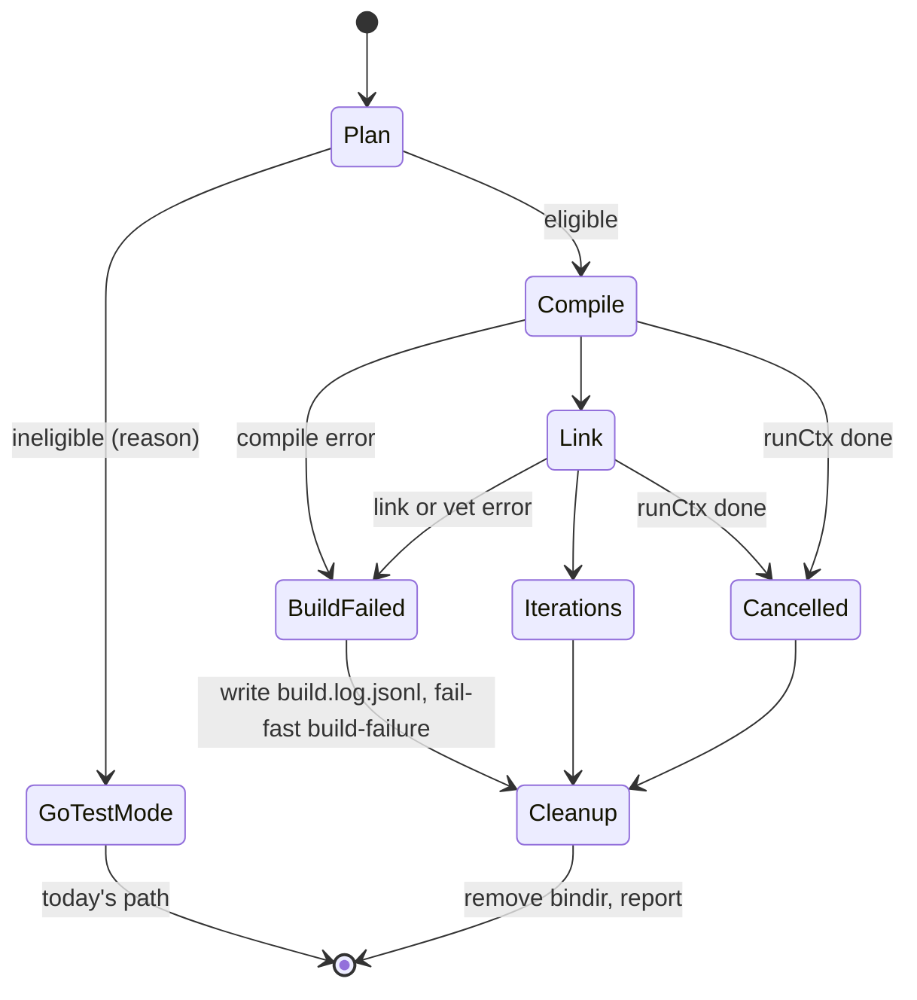

# Design: Build test binaries once and report build overhead

## Context

`diagnose` lives in `internal/runner`. `runDiagnoseIterations` resolves the module with `modresolve.ResolveArgs`, then
starts one `diagnoseWorker` per `diagnoseIterationResource`. Each worker runs reset, iteration setup,
`hooks.runIteration` (default `diagnoseIteration`), teardown, then digests the iteration log.

`diagnoseIteration` does three jobs at once. It builds the argv (`buildDiagnoseArgs`: `go test -json`, user args,
`-shuffle`, `-count=1`). It runs `go` in the module directory with `os.Environ()` plus the resource's `Env`. It streams
stdout and stderr into `iteration-N.log.jsonl` and drives the live progress line. The worker times the whole thing as
the iteration `Duration`.



Invariants this change must keep:

- The analyzer reads `go test -json` events keyed by `Package` and `Test`. It uses `start`, `pass`, `fail`, `skip`,
  `output`, `Elapsed`, and `FailedBuild`. It does not need packages to arrive in any order, but each event must look
  like what `cmd/go` emits.
- A build failure triggers fail-fast with reason `build-failure`.
- Hooks are `func(context.Context) error`, and `runCtx` cancels in-flight work. Child processes get their own process
  group, `os.Interrupt` on cancel, and a 5s `WaitDelay`.
- `iteration_duration_*` in `ReportSummary` feeds `compare`'s speed rows.
- Resource `Env` differs per worker and is applied at run time.

Toolchain facts checked on Go 1.27.3:

- `go test -c -o <dir>/ <patterns>` builds many packages in one call and names binaries after the last import path
  element, not the package clause (`a/foo` with `package bar` writes `foo.test`). It fails with
  `cannot write test binary util.test for multiple packages` when two packages share that element, such as `a/util` and
  `b/util`. Packages with no test files
  produce no binary. It runs vet like `go test` does.
- `go list -export -test -deps` compiles every package and test variant into the build cache without linking test
  binaries.
- `-debug-actiongraph=<file>` works on both commands. Each action has `Mode` (`build`, `link`, `vet`, ...), `Package`,
  `Cmd` (`null` on a cache hit), `CmdReal`, `TimeStart`, and `TimeDone`. It is a hidden flag and does not change cache
  keys.
- Go caches compiled packages but never caches linked test binaries.

## Approach

### Two phases per run



The **compile step** fills the build cache and reports compile time and cache state. The **link step** then runs with a
warm compile cache, so its wall time is the link-and-vet floor that every `go test` iteration pays today. That
separation is why we compile and link with two commands instead of one.

### Packages and seams



`diagnoseIteration` keeps the results file, buffering, and progress UI. The process work moves behind one seam:

```go
// iterationExecutor writes one iteration's go test -json stream to w.
type iterationExecutor interface {
    Run(ctx context.Context, it iterationRun, w io.Writer) error
}

type iterationRun struct {
    Iteration   int
    ShuffleSeed int64
    Env         []string // resource env, appended to os.Environ()
}
```

`goTestExecutor` holds today's `exec.CommandContext("go", ...)` code. `prebuiltExecutor` holds the `gobuild.Build`. The
executor is chosen once per run and stored on `diagnoseWorker`. Tests that inject `hooks.runIteration` keep working.

### Plan: split args and decide eligibility

`gobuild.Plan` takes the module dir, the resolved go test args, `GOFLAGS`, and every resource `Env`. It returns build
flags, translated test flags, package patterns, and passthrough args (after `-args`), or a fallback reason.



The flag tables mirror `go help testflag` and `go help build`. Unknown flags fall back rather than guess. Fallback runs
today's path and records `build.mode = "go-test"` with the reason. The terminal prints the reason once.

Test-flag defaults copy `cmd/go`:

- `-test.v=test2json` always, plus `-test.v=true` semantics when the user passed `-v`.
- `-test.paniconexit0`.
- `-test.timeout=10m0s` when the user did not set `-timeout`.
- `-test.count=1` when the user did not set `-count` (today's `buildDiagnoseArgs` rule).
- `-test.shuffle=<seed>` per iteration.

### Compile and link

`Compile` runs `go list -export -test -deps -json -debug-actiongraph=<tmp> <buildflags> <patterns>`. From the JSON it
keeps, for each pattern-matched package with tests: `ImportPath`, `Name`, `Dir`, whether it has test files, and whether
any dep in its test binary has `CgoFiles`. Compile errors (`Error`, `DepsErrors`) become a build failure.

`Link` groups packages so no group has two packages with the same binary base name, the last import path element that
`go test -c -o <dir>/` uses. It runs one `go test -c -o <bindir>/<g>/` per
group, sequentially, with the same build flags. Each group gets its own actiongraph file. When the user did not set
`-ldflags` in args or `GOFLAGS`, it adds `-ldflags=-s -w`. A user `-ldflags` turns stripping off instead of merging, so
we never override user link flags.

The binary dir comes from `os.MkdirTemp("", "testrig-bin-")`. The runner removes it after the last iteration, on
error, and on cancel.

Build metrics come from the actiongraphs:

```go
type BuildMetrics struct {
    Mode           string        `json:"mode"`                      // "prebuilt" | "go-test"
    FallbackReason string        `json:"fallback_reason,omitempty"`
    Cache          string        `json:"cache"`                     // "warm" | "partial" | "cold" | "unknown"
    CompileActions int           `json:"compile_actions"`
    CompileCached  int           `json:"compile_cached"`
    CompileWall    time.Duration `json:"compile_wall"`              // wall of the compile step
    CompileTotal   time.Duration `json:"compile_total"`             // sum of CmdReal over compiles that ran
    LinkWall       time.Duration `json:"link_wall"`                 // wall of the link step = floor
    LinkTotal      time.Duration `json:"link_total"`
    VetTotal       time.Duration `json:"vet_total"`
    Binaries       int           `json:"binaries"`
    ExternalLink   int           `json:"external_link"`             // binaries with non-std cgo deps
    Stripped       bool          `json:"stripped"`
    Floor          time.Duration `json:"floor"`                     // per-iteration overhead go test would pay
    SavedEstimate  time.Duration `json:"saved_estimate,omitempty"`  // Floor × (iterations − 1)
}
```

`Cache` is `warm` when at least 95% of compile actions were hits (the generated test mains always compile), `cold` when
at most 5% were hits, and `partial` between. If the actiongraph is missing or fails to parse, we keep the wall times
and set `Cache` to `unknown`. The build never fails because of metrics.

`ExternalLink` counts binaries whose test deps include a package with `CgoFiles` outside `runtime/cgo`, `net`, and
`os/user`. It is a heuristic, and the label says "likely external link".

`Report` gains `Build *BuildMetrics` (`json:"build,omitempty"`). `RunMeta` stays as it is. In go-test mode, `Build`
holds only `Mode` and `FallbackReason`, and iteration durations still include build time, as they do today.

### Prebuilt executor

For one iteration, the executor runs every binary with at most `P` running at once. `P` is the user's `-p` when set,
else `runtime.GOMAXPROCS(0)`, the same as `go test`. Packages with no test files get the events `cmd/go` emits for
them (`start`, the `?   pkg [no test files]` output, and `skip`) with no process.



The converter is a vendored copy of `cmd/internal/test2json` under its BSD license. Copying beats `go tool test2json`,
which would add a process per package per iteration. After the binary exits, the executor writes the line `cmd/go`
writes, and the converter turns it into the package's final event with `Elapsed`:

- exit 0 → `ok  \t<pkg>\t<s>s` (with `[no tests to run]` when the binary reports it).
- non-zero exit after a `FAIL` line → `FAIL\t<pkg>\t<s>s`.
- non-zero exit with no `FAIL` line (for example `os.Exit(1)` in `TestMain`) → `exit status N` then `FAIL\t<pkg>\t<s>s`.

Timeouts match `cmd/go`. The binary enforces `-test.timeout` itself and panics with `test timed out`. The executor also
kills it at timeout plus one minute and writes `*** Test killed: ran too long (<d>).` like `cmd/go`. On `runCtx` cancel
it sends `os.Interrupt` to the process group, waits 5s, then kills. Buffered packages still flush, so a graceful stop
keeps finished packages.

Per-package buffering keeps each package's events together, like `go test` output. A package that is still running at
cancel time flushes what it has.

### Lifecycle and failures



A build failure stops the run before any iteration, the same outcome as today's fail-fast on `build-failure`, but
reported once. The build output goes to `build.log.jsonl` as `go test -json` style `build-output` and `build-fail`
events, and `printBuildError` reads that file instead of `iteration-0.log.jsonl`.

Iteration hooks run inside the iteration, after the build. A setup hook that changes Go sources between iterations
breaks prebuilt mode. The docs say so, and `--build-once=false` restores today's behavior.

### CLI and output

- `--build-once` (bool, default `true`). `false` forces go-test mode.
- `--strip-binaries` (bool, default `true`). Controls `-ldflags=-s -w` in the link step.

Both go through `config.App` and the Cobra flag registry like the other diagnose flags. They are not lifecycle hooks, so
the hook catalog is untouched.

### Terminal output

The build phase must say what it is doing, in the same style as the rest of the run. The existing conventions it
follows:

- A live step is one inline line redrawn every 250ms with `out.RedrawInline`: a `termstyle.Label` verb, then a
  `progressBracket` with `Muted` elapsed time. `analyzing [3s]` is the model.
- A failed step leaves the line in place with a `Bad` `❌`, like `analyzing [3s] ❌`.
- Counts in progress go in a `Label` bracket, like the iteration counter `[3/20]`.
- Details are `Muted` and joined with ` · `, like the summary scope line.
- Notices that change how the run behaves are `Accent`, like the graceful-stop notice.
- Without live inline progress (no TTY), steps print a `Muted` "started" line and a final line, like
  `iteration 1/5 started`.
- `--ai-output` gets short machine tokens instead of styled text.

All build output goes through a small `buildProgress` helper in `internal/runner`, next to
`startDiagnoseAnalyzingProgress`, so both share one look.

Live run with a TTY. Each step redraws in place, then settles into a finished line:

```text
compiling [12s]                                   ← live, redraws
compiled [41.2s] · 1910 packages · 78 cached · cold cache
linking [37/175] [31s]                            ← live; count from binaries written to the bin dir
linked [78.4s] · 175 test binaries · 12 likely external link (cgo) · stripped
build floor 78.4s per iteration · saves ~24m50s over 20 iterations

 Iter  Result     Tests  Skipped  Failures  Timeouts      Slow     Runtime
──────────────────────────────────────────────────────────────────────────
```

Styles in that sample: `compiling`, `compiled`, `linking`, `linked`, and the `37/175` count are `Label`. Brackets and
details are `Muted`. The cache state is `OK` when warm, `Accent` when partial or cold, and `Muted` when unknown. The
floor line is `Muted`, with the floor value in `Label`. The iteration table starts after a blank line and is unchanged.
Its `Runtime` column is now test time only.

Step labels use the words a Go user already knows: compiling and linking. The link step includes vet, as `go test` does.
When vet takes a meaningful share of it (5% or more), the linked line adds `· vet 4.1s`.

Without a TTY:

```text
compile started
compiled [41.2s] · 1910 packages · 78 cached · cold cache
link started · 175 test binaries
linked [78.4s] · 175 test binaries · 12 likely external link (cgo) · stripped
build floor 78.4s per iteration · saves ~24m50s over 20 iterations
```

Go-test mode prints one `Accent` notice before the table, so users know iteration times include building:

```text
building per iteration: -coverprofile needs go test · iteration times include compile and link
```

With `--build-once=false`, the reason reads `--build-once=false`.

Failures and interrupts:

- A compile or link error leaves `compiling [3s] ❌` or `linking [12/175] [9s] ❌`, then the existing `BUILD ERROR`
  block from `printBuildError`, read from `build.log.jsonl`.
- Ctrl+C during the build cancels right away, since there are no finished iterations to keep. The line ends with an
  `Accent` `stopped`, for example `linking [12/175] [9s] stopped`. The graceful-stop notice stays for the iteration
  phase only.

End of run. `PrintSummary` prints a `Muted` build line just above the existing scope line, using the same ` · ` style:

```text
  build compile 41.2s (cold) · link 78.4s · floor 78.4s/iter · saved ~24m50s
  1432 tests · 20 iters · slow ≥ 30s · wall min 31.2s  p50 33.0s  max 36.8s
```

In go-test mode the build line reads `build per iteration (-coverprofile needs go test)`. The `Diagnosis Complete!
[wall]` line keeps its total wall time, which includes the build.

`--ai-output`:

- Stderr gets `build_start` and then `build_compile s=41 cache=cold pkgs=1910 cached=78` and
  `build_link s=78 bins=175 ext=12 strip=1 floor_s=78`, the same `key=value` shape as `stop_graceful`.
- Go-test mode prints `build_mode go-test reason=<token>` once. Tokens are short flag names such as `coverprofile`
  or `build-once-off`.
- Build failure prints `build_fail step=compile|link` before the existing build error output.
- The completion JSON gains `build` with the `BuildMetrics` fields.
- `lpr_s` keeps its current meaning, an upper bound for the whole run.

### Compare

`compare` adds a **Build** table: mode, cache state, compile wall, link wall, floor, binaries, external links, and
stripped. It uses the same `row` shape and `durationOrDash`. When the two runs use different modes, the speed section
adds a note that iteration durations are not comparable, because go-test durations include the build floor.

### Rejected options

- **`-toolexec` timing wrapper.** It times each tool exactly, but `-toolexec` is part of the cache key. Every run would
  start cold and miss the user's normal cache.
- **One `go test -c` for compile and link.** Simpler, but compile and link overlap, so we cannot get a clean floor.
- **`go test -run '^$'` to measure the floor.** It costs a full extra link and still leaves us building binaries.
- **Calling `go tool test2json` per binary.** It adds one process per package per iteration, a few thousand on large
  repos.

## Verification

Standard checks: `golangci-lint run ./... --fix` and `go test ./...`.

Equivalence is the main proof. Add fixture modules under `internal/runner/testdata/prebuilt/` and an integration test
that runs each fixture both ways. It normalizes events by dropping `Time`, `Elapsed`, and timing numbers in output, and
asserts the same event multiset and the same `Report` minus durations. Cover:

- passing, failing, and skipped tests, subtests, and `t.Parallel`;
- a test that reads `testdata/` by relative path, which proves the working directory;
- a panic, `os.Exit(0)` in a test (`paniconexit0`), and `os.Exit(1)` in `TestMain`;
- `-timeout 1s` with a hanging test, which needs the binary's own timeout panic and a `timeout` classification;
- `-race` with a known race, which needs a `race` classification;
- a package with no test files and one with no tests matching `-run`;
- two packages with the same name, which needs name grouping;
- `-shuffle` with a fixed seed, which needs the same order both ways;
- args after `-args`, which must reach the binary.

Other checks:

- Plan table tests: every flag in `go help testflag` and `go help build` is classified, unknown flags fall back,
  `-ldflags` in args or `GOFLAGS` turns off stripping, and resource `Env` with `GOFLAGS` or `CGO_ENABLED` falls back.
- Actiongraph parser tests on recorded actiongraph JSON for warm, cold, partial, and malformed input.
- A compile error fixture: the run stops before iteration 0, `build.log.jsonl` exists, fail-fast reason is
  `build-failure`, and the build error prints.
- Cancel during the link step and during an iteration: no orphan processes, the binary dir is gone, and finished
  packages are in the log.
- `--parallel-iterations 3` with per-worker env: each binary sees its worker's env.
- Output golden tests for each state in "Terminal output": live, non-TTY, `--ai-output`, go-test notice, compile `❌`,
  link `❌`, and `stopped`. Then run once by hand in a real terminal to confirm the redraw clears cleanly before the
  iteration table.
- `compare` golden tests: two prebuilt runs, one prebuilt run against one go-test run (with the note), and an old report
  with no `build` key.
- Manual run on a large repo with `--iterations 5`, both modes. Expect per-iteration time to drop by about the reported
  floor, and flake classifications to match.

## Risks

- **Semantic drift from `go test`.** A missed default flag, env var, or exit-code rule changes results without errors.
  The equivalence suite is the guard. Users can set `--build-once=false`, and the report records the mode, so a
  mismatch shows up when compared against a go-test run.
- **Hidden `-debug-actiongraph` flag.** A Go release could change or drop it. Metrics then degrade to wall times and
  `cache: unknown`. A test against the toolchain in `go.mod` catches the change.
- **Disk use.** Hundreds of test binaries can use many GB in the temp dir. Stripping helps. Successful, failed, and
  canceled runs remove the dir; a crash or SIGKILL can leave it behind, and the `testrig-bin-` prefix makes it easy to
  find. The docs say where it lives.
- **Hooks that change sources mid-run.** They break prebuilt mode silently. The docs name this, and the flag opts out.
- **Memory with `P` binaries times parallel iterations.** This is unchanged from today, where each `go test` already
  runs `-p` binaries. The link step now runs once instead of in every worker, so peak memory should drop.
- **External link heuristic.** It can over- or under-count. It is labeled as likely and only affects reporting.
- **Older reports.** `build` is optional, so `compare` and `ReadReport` must handle its absence. Golden tests cover it.

## TODO

Effort: hard (matching `go test` process semantics exactly while threading a new build phase through cancellation,
workers, reports, and compare needs deep reasoning across several packages)

### Phase 1: Build phase and build metrics

- [x] Add `internal/gobuild` with `Plan`, `Compile`, `Link`, and the actiongraph parser. Wire a build phase into
      `runDiagnoseIterations` behind `--build-once` (default `false` in this phase), with bindir cleanup on success,
      error, and cancel. Write `Report.Build`, the terminal build line, and the `--ai-output` field. Iterations still use
      `go test`. Include the plan table tests, actiongraph parser tests, and the name-collision fixture.
- [x] Add the `buildProgress` helper and the build output from "Terminal output": live and non-TTY step lines, the
      `[n/total]` link count from the bin dir, the floor line, the summary build line, and the `--ai-output` tokens.
      Include golden tests for live, non-TTY, and AI output, with styles checked through the existing test printer.
- [x] Move build failures to the build phase when `--build-once` is on: write `build.log.jsonl`, fail fast with
      `build-failure` before iteration 0, and point `printBuildError` at the new file. Show `❌` on the failed step and
      `stopped` on interrupt. Include the compile-error fixture and the cancel-during-link test, both checking the
      printed lines.

### Phase 2: Run prebuilt binaries

- [x] Vendor `cmd/internal/test2json` into `internal/test2json` with its license. Add the `iterationExecutor` seam, move
      today's code into `goTestExecutor`, and add `prebuiltExecutor`: `-p` scheduling, package dir and `PWD`, env,
      test-flag translation and defaults, finish lines, timeout kill, no-test-files events, per-package buffering, and
      process-group cancel. Land the full equivalence suite with it.
- [ ] Turn on `--build-once` by default and add `--strip-binaries`. Make go-test mode record its fallback reason and
      print the `Accent` "building per iteration" notice, the summary build line, and the `build_mode` AI token. Set
      `SavedEstimate`. Include the parallel-iterations env test and the cancel-mid-iteration test.

### Phase 3: Compare and docs

Effort: medium (follows existing compare row and golden-test patterns, plus living docs for a new concept)

- [ ] Add the Build table and the mixed-mode speed note to `compare`, with golden tests for prebuilt vs prebuilt,
      prebuilt vs go-test, and an old report without `build`.
- [ ] Docs: add a concept doc for the build phase (modes, fallback rules, floor, cache states, hooks caveat, temp dir)
      and a reference doc for the `build` report fields and the two flags. Run `good-vibes docs lint` and
      `good-vibes docs index`.
