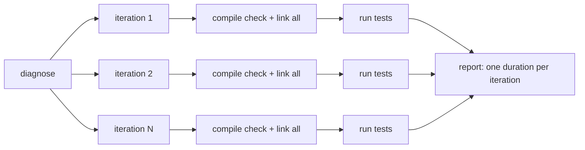
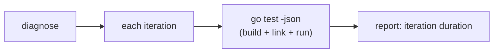
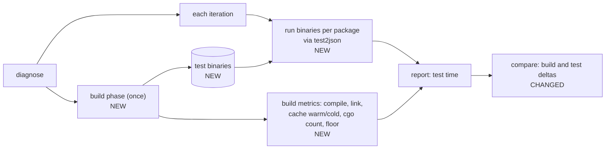

# Build test binaries once and report build overhead

## Context

`diagnose` runs `go test -json` once per iteration. Every iteration re-checks the build cache and re-links every test
binary, even though nothing changed between iterations. Go caches compiled packages but not linked test binaries, so
the link runs every time.

On one large repo, 20 iterations re-linked 175 test binaries each time. About 80s of each ~114s iteration was build and
link work, not tests. That hurts three ways:

- Runs take far longer than the tests need.
- Iteration durations mix build time with test time, so duration stats and `compare` results are polluted. A change
  that speeds up linking looks like a test speedup, and link noise hides real test regressions.
- Users can't tell whether fixing tests can still help, because they never see the build floor.

## Goals and non-goals

Goals:

- Build each test binary once per run, then run the binaries for every iteration.
- Measure build overhead on its own: compile time, link time, and whether the build cache was warm or cold.
- Report build overhead separately from test time in the JSON and Markdown reports, and in `compare`.
- Report a "build/link floor": the time `go test` spends before any test runs.
- Report how many packages link externally (cgo), since that is the usual cause of slow links on macOS.
- Keep test results the same as `go test` gives: same working directory, env, flags, and `-json` events.

Success: on the repo above, per-iteration time drops close to test time alone, and the report shows the ~80s as build
overhead paid once.

Non-goals:

- Speeding up the user's own `go build` or `go test` outside testrig.
- Changing the user's `GOFLAGS`, tags, `-race`, `-cover`, or other cache-key settings.
- Auto-tuning `-p` or splitting cores between parallel iterations. We may report contention, but not fix it here.
- Caching binaries across separate testrig runs.

## Decision

Split each run into a **build phase** and a **run phase**. The build phase runs once: a warm-up build, then one test
binary per package, timed and tagged with cache state. The run phase executes those binaries for every iteration, from
each package's directory, with `go test` flags translated to `-test.*` and output fed through `test2json`. Reports gain a
build section next to the existing test-time stats.

Before:

After:

The link step is also stripped of debug info inside testrig only. It is cheap and cuts link time further. Flags that
can't run against a prebuilt binary fall back to today's `go test` path, and the report says so.

Why this beats the alternatives:

- **Only stripping debug info** cuts maybe 20–30% of link time but still links every iteration. It is a small part of
  this change, not a substitute.
- **Only measuring overhead** (a single `go test -run '^$'` pass) gives the floor but leaves every iteration paying it.
  We keep the floor as a reported number and also stop paying it.
- **Parsing `go test -x` timings each iteration** separates the numbers but keeps the cost.

Why `hard`: running a prebuilt binary must match `go test` semantics exactly (working directory, flag translation,
timeouts, build failures, package-level output, `-json` events, signal handling), and a subtle mismatch silently changes
which tests look flaky. The change also spans the runner, reports, and `compare`, and must keep build-cache keys stable.
