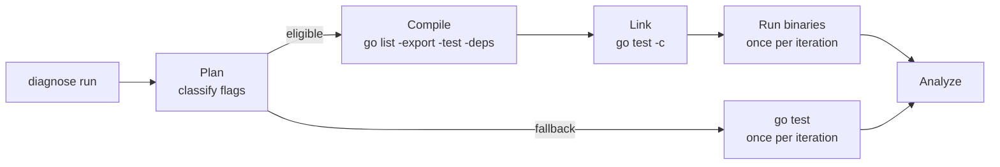

# Build Phase

## Overview

A normal `go test` run compiles and links the test binaries as part of the command. `diagnose` repeats that work
every iteration, even when nothing changed. The build phase moves the work to the start of the run: one compile, one
link, then the same binaries run for every iteration.



The phase has two modes.

- **prebuilt** (default): compile and link once, then run the linked binaries.
- **go-test** (fallback): keep today's behavior and run `go test` for every iteration.

`report.json` records the mode and the reason for a fallback. Iteration durations mean different things in each mode:
in prebuilt mode they contain test time only, while in go-test mode they also contain compile and link time.

## How it works

### Plan

`gobuild.Plan` classifies the resolved `go test` arguments before any process runs. Build flags such as `-race`,
`-tags`, and `-ldflags` go to the compile and link commands. Test flags such as `-run`, `-skip`, `-v`, and `-timeout`
become `-test.*` flags for the binary. Arguments after `-args` pass through to the binary. Everything left is a package
pattern.

The plan also supplies the defaults `cmd/go` would supply: `-test.paniconexit0`, `-test.v=test2json`,
`-test.timeout=10m0s` when the user did not set `-timeout`, and `-test.count=1` when the user did not set `-count`.
The shuffle seed becomes `-test.shuffle` for each iteration.

The run falls back to go-test mode when it cannot honor an argument or environment:

- `--build-once=false`.
- A flag that changes output, coverage, profiling, or execution: `-cover*`, `-cpuprofile`, `-memprofile`,
  `-blockprofile`, `-mutexprofile`, `-trace`, `-fuzz*`, `-exec`, `-c`, `-o`, `-outputdir`, or `-n`.
- An unknown flag. The plan never guesses.
- A resource environment entry that changes build inputs: `GOFLAGS`, `GOOS`, `GOARCH`, `GOEXPERIMENT`, `CC`, `CXX`,
  or any `CGO_*` key. Each diagnose worker gets its own environment, so one shared build cannot honor these.

The fallback still records the mode and reason, so a report never hides why iteration times include building.

### Compile

The compile step runs:

```sh
go list -export -test -deps -json -debug-actiongraph=<tmp> <build flags> <patterns>
```

It fills the build cache with every package and test variant, including the generated test mains. It also collects the
package metadata used later: import path, directory, whether the package has test files, and whether a test binary
likely links against cgo. Packages with no test files are recorded; they get `go test -json` events later without a
process.

Compile errors stop the run before iteration 0. `diagnose` writes the go command output to `build.log.jsonl` and
reports the existing `build-failure` fail-fast reason.

### Link

The link step runs `go test -c -o <bindir>/<group>/` once per name group. `go test -c -o <dir>/` names a binary after
the last element of its import path, so `a/util` and `b/util` cannot share one call. The plan groups packages so no
group has two packages with the same binary name, then links the groups one after another.

Linking includes vet, as `go test` does. When the user did not set `-ldflags` in the arguments or `GOFLAGS`, the link
step adds `-ldflags=-s -w` to strip the binaries. A user `-ldflags` turns stripping off instead of merging, so testrig
never overrides user link flags.

### Floor

The compile step warms the cache, so the link step measures the work every `go test` iteration would repeat. That link
wall time is the **build floor**. It covers link and vet, not test execution.

`diagnose` reports the floor per iteration and estimates the savings as `floor × (iterations − 1)`. The estimate is a
counterfactual: it says what the run would have paid to link once per extra iteration.

### Iterations

The prebuilt executor runs each test binary with its package directory as the working directory and the worker's
resource environment. At most `P` binaries run at once: the user's `-p` when set, otherwise `runtime.GOMAXPROCS(0)`,
the same limit `go test` uses.

Each binary's stdout and stderr go through a vendored copy of `cmd/internal/test2json`, so the result log has the same
event shape as `go test -json`. Events stay in per-package buffers and flush together when a package finishes.
Packages with no test files produce the same `start`, `[no test files]`, and `skip` events without a process.

The binary enforces `-test.timeout` itself. The executor also kills a binary at the timeout plus the larger of one
minute or a tenth of the timeout, and writes the `*** Test killed: ran too long` line like `cmd/go`. On cancellation it
interrupts the process group, waits five seconds, then kills it. Finished packages still flush their logs.

### Cache states

The compile action graph classifies how much of the build cache was already warm. The generated test mains always
compile, so a real run rarely reaches a perfect hit rate.

| State | Meaning |
| --- | --- |
| `warm` | At least 95% of compile actions were cache hits. |
| `partial` | Between 5% and 95% were hits. |
| `cold` | At most 5% were hits. |
| `unknown` | The action graph was missing, malformed, or had no compile actions. |

A missing or unreadable action graph never fails the build. The report keeps the wall times and says `unknown`.

### Hooks and source changes

Global setup runs before the build phase, so files it changes are part of the compiled binaries. Iteration setup runs
inside each iteration, after the build, so any Go source or generated file it changes is invisible to prebuilt
binaries. Tests keep running the code that was linked at the start of the run.

If an iteration hook must change sources between iterations, pass `--build-once=false`. That restores today's `go test`
path, where every iteration sees the hook's changes.

### Failures and cleanup

A compile or link failure stops the run before iteration 0. The step line shows a failure marker, `build.log.jsonl`
holds the go command output as `build-output` and `build-fail` events, and the run records `build-failure` as the
fail-fast reason. A build failure is reported once, not once per iteration.

The binary directory comes from `os.MkdirTemp("", "testrig-bin-")`. It lands under the operating system temp directory,
usually `$TMPDIR/testrig-bin-*` on macOS. The runner removes it after the last iteration, on a build error, and on
cancellation. A crash or `SIGKILL` can leave it behind; the prefix makes it easy to find and delete.

## Trade-offs

The build phase trades disk and a little complexity for much shorter iterations. Hundreds of test binaries can use
several gigabytes, and stripping only reduces that. The binaries are thrown away at the end of the run.

The metrics rely on `-debug-actiongraph`, a hidden `go` flag. If a Go release changes or removes it, the run still
works: cache state becomes `unknown` and the wall times remain. A toolchain upgrade should be checked against the build
tests.

Prebuilt mode can drift from `go test` if a default flag, environment variable, or exit-code rule is missed. The
equivalence fixtures compare both modes on passing, failing, skipping, parallel, panic, timeout, race, shuffle, and
`-args` cases. The report records the mode, so a difference is visible when comparing a prebuilt run with a go-test run.

The `external_link` count is a heuristic. It counts binaries whose test dependencies include a package with cgo files
outside `runtime/cgo`, `net`, and `os/user`. It is labeled as likely and only affects reporting.

## Related

- [Build report and flags](../reference/build.md) for the `build` object and the two diagnose flags.
