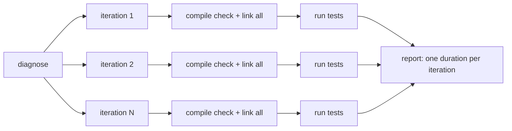
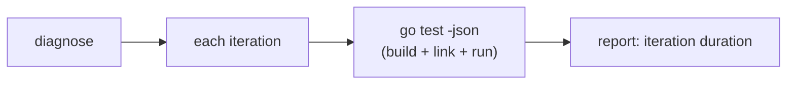
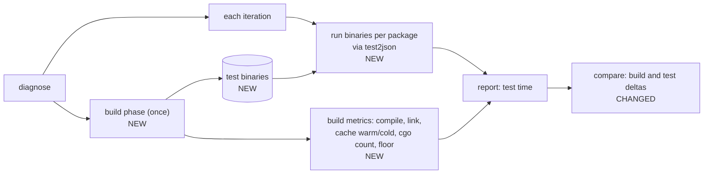

# Build test binaries once and report build overhead

## Context

`diagnose` runs `go test -json` once per iteration. Every iteration re-checks the build cache and re-links every test
binary, even though nothing changed between iterations. Go caches compiled packages but not linked test binaries, so
the link runs every time.

On one large repo, 20 iterations re-linked 175 test binaries each time. About 80s of each ~114s iteration was build and
link work, not tests. That hurts three ways:

- Runs take far longer than the tests need.
- Iteration durations mix build time with test time, so duration stats and `compare` results are polluted. A change
  that speeds up linking looks like a test speedup, and link noise hides real test regressions.
- Users can't tell whether fixing tests can still help, because they never see the build floor.

## Goals and non-goals

Goals:

- Build each test binary once per run, then run the binaries for every iteration.
- Measure build overhead on its own: compile time, link time, and whether the build cache was warm or cold.
- Report build overhead separately from test time in the JSON and Markdown reports, and in `compare`.
- Report a "build/link floor": the time `go test` spends before any test runs.
- Report how many packages link externally (cgo), since that is the usual cause of slow links on macOS.
- Keep test results the same as `go test` gives: same working directory, env, flags, and `-json` events.

Success: on the repo above, per-iteration time drops close to test time alone, and the report shows the ~80s as build
overhead paid once.

Non-goals:

- Speeding up the user's own `go build` or `go test` outside testrig.
- Changing the user's `GOFLAGS`, tags, `-race`, `-cover`, or other cache-key settings.
- Auto-tuning `-p` or splitting cores between parallel iterations. We may report contention, but not fix it here.
- Caching binaries across separate testrig runs.

## Decision

Split each run into a **build phase** and a **run phase**. The build phase runs once: a warm-up build, then one test
binary per package, timed and tagged with cache state. The run phase executes those binaries for every iteration, from
each package's directory, with `go test` flags translated to `-test.*` and output fed through `test2json`. Reports gain a
build section next to the existing test-time stats.

Before:

After:

The link step is also stripped of debug info inside testrig only. It is cheap and cuts link time further. Flags that
can't run against a prebuilt binary fall back to today's `go test` path, and the report says so.

Why this beats the alternatives:

- **Only stripping debug info** cuts maybe 20–30% of link time but still links every iteration. It is a small part of
  this change, not a substitute.
- **Only measuring overhead** (a single `go test -run '^$'` pass) gives the floor but leaves every iteration paying it.
  We keep the floor as a reported number and also stop paying it.
- **Parsing `go test -x` timings each iteration** separates the numbers but keeps the cost.

Why `hard`: running a prebuilt binary must match `go test` semantics exactly (working directory, flag translation,
timeouts, build failures, package-level output, `-json` events, signal handling), and a subtle mismatch silently changes
which tests look flaky. The change also spans the runner, reports, and `compare`, and must keep build-cache keys stable.

## Consequences

`diagnose` now pays the compile and link cost once per run instead of once per iteration. On a repo with 175 test
binaries and 20 iterations, that turns roughly 80s of repeated link work into a single build step and a reported floor.
Iteration durations become test time only, so duration stats, the slow-test table, and `compare` speed rows stop mixing
build noise with test behavior.

The cost side:

- **Two modes in one report.** Duration fields mean different things in prebuilt and go-test mode. `compare` prints a
  note when modes differ, but anyone reading a single `report.json` has to check `build.mode` before trusting a duration.
- **A hidden toolchain dependency.** Cache state, compile totals, and vet totals come from `-debug-actiongraph`, an
  undocumented `go` flag. If a Go release drops it, metrics degrade to `unknown` rather than failing, but the numbers
  quietly get thinner.
- **Disk.** Prebuilt mode writes hundreds of test binaries under `$TMPDIR/testrig-bin-*`. A crash or `SIGKILL` leaves
  them behind; the prefix is the only cleanup signal.
- **A vendored copy of `cmd/internal/test2json`.** Avoids a process per package per iteration, but it has to be resynced
  by hand when the Go version in `go.mod` changes.
- **Iteration hooks that touch Go sources stop taking effect.** The docs name the caveat and `--build-once=false`
  restores the old behavior, but it is a silent difference for a hook author who never reads them.

What we would revisit: the disk footprint and binary lifetime (caching binaries across runs stayed out of scope), the
`external_link` cgo heuristic, and whether `compare` should compute compile/link deltas rather than only showing values.

## Alternatives considered

- **Strip debug info only.** `-ldflags=-s -w` cuts maybe 20–30% of link time and costs almost nothing, but every
  iteration still links. We kept it as a sub-feature (`--strip-binaries`) rather than the whole change.
- **Measure the floor without removing it.** A single `go test -run '^$'` pass reports what the build costs, and parsing
  `go test -x` timings separates build from test time. Both leave every iteration paying the full link. We kept the floor
  as a reported number and also stopped paying it.
- **`-toolexec` timing wrapper.** Gives exact per-tool timings, but `-toolexec` is part of the build cache key. Every run
  would start cold and miss the user's normal cache, which is a far worse trade than imprecise metrics.
- **One `go test -c` for compile and link.** Simpler, but compile and link overlap inside the call, so there is no clean
  separate compile time and no clean floor. Two commands cost a little orchestration and buy the separation.
- **Shelling out to `go tool test2json` per binary.** Correct by construction, but it adds one process per package per
  iteration — a few thousand extra spawns on a large repo. Copying the converter under its BSD license avoids that.

## Implementation notes

Where the design was wrong or incomplete:

- The binary name is the **last import path element**, not the package clause. Verified against the toolchain: `a/foo`
  with `package bar` writes `foo.test`, and `a/util` plus `b/util` collide regardless of package name. Name grouping
  keys on the import path, and a `/vN` element is skipped.
- The timeout kill grace is `timeout + max(1min, timeout/10)`, matching `cmd/go`, not the flat plus-one-minute the
  design first described.
- Shuffle precedence is resolved inside the executor: `iterationTestFlags` drops any existing `-test.shuffle` when the
  harness supplies a non-zero seed. Stripping the harness flag before `Plan` would have split the seed between the
  report and the binary flags.
- `-v` needed no special case once injected flags come before user flags: the user's `-test.v=true` follows the
  `-test.v=test2json` default and wins.
- `exit status N` is written only when the binary produced no test output, not merely when no `FAIL` line appeared. A
  `TestMain` that prints and then exits non-zero gets no `exit status` line, which matches `go test -json`.
- A compile failure logs stderr (falling back to stdout) rather than the partial `go list -json` dump that `go list`
  writes before failing.
- Wall times reuse `formatDiagnoseWallClock`, so lines read `41.20s` and `1m18.40s` rather than the one-decimal samples
  in the design.
- `compare` omits the Build section entirely when neither report has `build`, and renders dashes for go-test-mode
  metrics rather than zeros. Zeroes would read as measured data; a dash says "not measured in this mode."

Limits a user or maintainer will hit:

- The action graph parser is tested against recorded JSON only. No test runs the real `-debug-actiongraph` flag, so a
  toolchain change shows up as `cache: unknown`, not a failure.
- Cancellation signals a process group on unix. Windows and other targets signal only the direct child.
- The equivalence suite compares per-package event sets and test order, not cross-package stdout ordering. Bench is
  covered by a unit test, not end to end.
- The `external_link` count is a heuristic and only feeds reporting.

## Follow-ups

- Add an actiongraph smoke test that runs the real `-debug-actiongraph` flag against the toolchain in `go.mod`, skipping
  when the flag is unavailable, so a Go upgrade fails loudly instead of degrading to `unknown`.
- Add a full `RunIterations` test for cancellation during the compile and link steps. Today cancel coverage there is at
  the build-phase level, separate from the iteration cancel test.
- Add an end-to-end equivalence scenario for `-bench`, and record in the docs that `-fuzz`, `-cover*`, and `-exec` fall
  back to go-test mode by design rather than by omission.
- Add a `compare` golden for a prebuilt report with `cache: unknown`, to lock the wording and styling of the degraded
  case.
- Decide whether the Build table should carry a change column (compile and link deltas) or stay values-only, and write
  the decision down.
- Report peak or final binary disk use, so the disk cost of prebuilt mode is visible instead of surprise.
- Implement process-group cancellation for Windows, or document the reduced behavior in the build concept doc.
- Add a worked example of a real `report.json` build section to the build report reference; the current example is
  synthetic.
